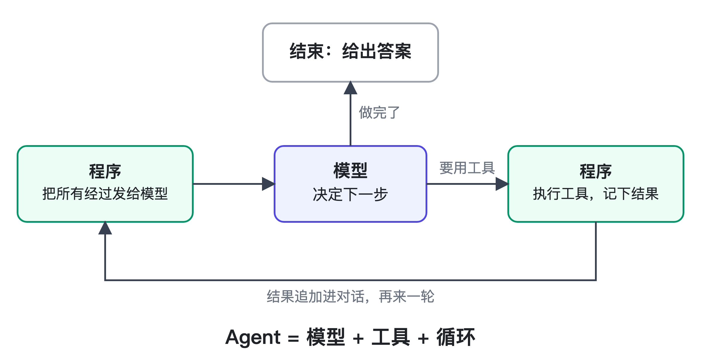

# 第 1 天｜Agent 是什么：先跟模型说上话

> 《从 0 到 1，14 天入门 Agent 开发》第 1 篇。代码在仓库的 `day01/` 目录。

这个系列是一条 Agent 开发的入门路线，分成 14 天，每天一篇文章、一份能跑的代码。

网上的 Agent 教程大多从框架讲起：装好 LangChain，抄十几行代码，一个"智能体"就跑起来了。可跑起来以后呢？它为什么会去调用工具？为什么有时候原地打转？上下文满了怎么办？这些问题，框架都替你藏起来了。出了问题，你不知道该往哪儿查。

所以这个系列反过来走：

- **前 8 天不用任何框架。** 从一个最普通的 HTTP 请求开始，一天加一样东西，写出一个能读代码、会修 bug、动手之前先问你的代码助手。
- **第 9 天学 LangGraph，最后 3 天学 DeepAgents。** 到那时你会发现，框架里的每一个概念，都对得上你手写过的某几行代码。

这个系列尽量照顾零基础的朋友：每一步都写了要敲什么命令、应该看到什么结果、没看到的话怎么办。会一点编程更好，没有也没关系，跟着做就行。

## 今天的目标

1. 搞清楚 Agent 是什么。
2. 装好环境，拿到一个模型的 API key。
3. 用十几行代码跟模型说上话，再写一个命令行里的多轮对话。
4. 通过一个小实验，发现一件后面每天都会用到的事：**模型没有记忆。**

预计用时：第一次装环境大约 30–60 分钟，后面的内容 30 分钟。

## 一、Agent 是什么

### 从一个你可能用过的场景说起

在 Claude Code 或者 Cursor 里说一句："有个测试过不了，帮我修好。"

它会先跑一遍测试，看哪里报错；然后打开相关的代码；改一处；再跑测试；还不行就接着改，直到测试通过，最后告诉你改了什么。

看起来像一个程序员在干活。把这个过程拆开，其实每一步都是同样的三件事：

1. 程序把"到目前为止发生的所有事"发给模型。
2. 模型回一句话。要么是最终答案，要么是一个请求："帮我跑一下测试""帮我读一下这个文件"。
3. 如果是请求，程序去执行，把结果追加进去，再回到第 1 步。

这就是 Agent 的全部骨架：



用一个公式记住它：**Agent = 模型 + 工具 + 循环**。

- **模型**负责想：下一步做什么。
- **工具**负责做：读文件、跑命令、查数据库。模型自己什么也执行不了，它只会说"我想调用哪个工具、参数是什么"，真正去执行的是你的程序。这是第 2 天的内容。
- **循环**把两者串起来，一直转到模型说"做完了"为止。第 3 天我们用不到 100 行代码写出这个循环。

Thorsten Ball 那篇很有名的《How to Build an Agent》，把它概括成一句话：一个模型，一个循环，足够的 token。

### 打个比方

模型像一个很聪明、但被关在房间里的顾问。他看不到你的电脑，也碰不到任何东西，只能通过门缝递纸条。

- 你递进去一张纸条，写着任务和目前的情况。
- 他递出来一张纸条："帮我看看 config.py 里写了什么。"
- 你去看，把内容抄在纸条上递进去。
- 他再递出来下一张："好的，问题在第 12 行，把它改成……"

Agent 程序就是门外那个跑腿的人：递纸条，按纸条上写的去做，再把结果递回去。

### Agent 和工作流有什么不一样

Anthropic 在《Building effective agents》里把这类系统分成两种：

- **工作流**：步骤由代码写死，模型只负责其中某几步。比如"先翻译，再校对，再排版"，顺序是你定的。
- **Agent**：下一步做什么，由模型自己决定。

能写死的，就写死。工作流更便宜、更稳定、出了问题也更好查。只有步骤没法提前确定的任务，比如"修一个你没见过的 bug"，才值得交给 Agent。真实的系统，大多是两者混在一起。

## 二、这 14 天我们做什么

做一个"代码仓库助手"，可以理解成迷你版的 Claude Code。它对着一个练习项目干活：仓库里的 `sample_repo`。这是一个很小的笔记服务，叫 tinynotes，有接口、有测试、有文档，还故意留了一个 bug。

- 第 3 天，它能自己翻文件，回答"这个项目怎么运行"。
- 第 5 天，它能找到失败的测试、改代码、再跑测试确认，改之前先给你看改了哪几行。
- 第 12 天，它会列计划、会派子 Agent 去调查、记得住你的习惯。
- 第 13 天，它有了网页界面：回答一个字一个字地出来，改文件前在浏览器里点批准。
- 第 14 天，它换上在自己电脑上跑的开源模型；顺便看看，哪些事其实不该交给 Agent。

## 三、准备环境

这一节一步一步来。每一步后面都写了"应该看到什么"，对上了再往下走。

### 第 1 步：打开终端

后面所有命令都在终端里敲。

- **macOS**：按 `Command + 空格`，输入"终端"，回车。
- **Windows**：按 `Win + X`，选"终端"或者"Windows PowerShell"。
- **Linux**：你应该已经知道了。

### 第 2 步：安装 uv

uv 是现在 Python 项目最常用的管理工具。它能帮你装好合适版本的 Python、建好项目专用的环境、装好所有依赖。LangChain 官方的项目模板用的也是它。

macOS 和 Linux：

```bash
curl -LsSf https://astral.sh/uv/install.sh | sh
```

Windows（在 PowerShell 里）：

```powershell
powershell -ExecutionPolicy ByPass -c "irm https://astral.sh/uv/install.ps1 | iex"
```

如果你的电脑上已经有 Python，也可以用 `pip install uv` 安装；用 Mac 和 Homebrew 的话，`brew install uv` 也行。

装完以后，**关掉终端再重新打开一个**，然后输入：

```bash
uv --version
```

**应该看到**：一行版本号，比如 `uv 0.13.1`。

**如果提示找不到命令**：多半是终端没重开，安装程序修改的环境变量还没生效。重开终端再试。

### 第 3 步：下载代码

有两种办法。

- **会用 Git**：

  ```bash
  git clone https://github.com/rainstudiome/agent-14-days.git
  cd agent-14-days
  ```

- **不会用 Git**：在 GitHub 的仓库页面点绿色的 Code 按钮，选 Download ZIP，下载后解压，然后在终端里用 `cd` 进到解压出来的目录。

  > 小技巧：在终端里输入 `cd`（后面带一个空格），然后把文件夹拖进终端窗口，路径会自动填好，回车就进去了。

**应该看到**：在这个目录里输入 `ls`（Windows 用 `dir`），能看到 `README.md`、`pyproject.toml`、`day01`、`sample_repo` 这些文件和目录。

### 第 4 步：安装依赖

在仓库目录里运行：

```bash
uv sync
```

uv 会做三件事：如果你的电脑上没有合适的 Python（这个系列需要 3.11 以上），就下载一个；在仓库里建一个 `.venv` 目录，作为这个项目专用的环境；把需要的库都装进去。

**应该看到**：一串下载和安装的输出，最后没有红色的 `error`。

**如果下载很慢或者失败**：国内访问默认的软件源比较慢，可以换成国内的镜像源：

```bash
uv sync --default-index https://pypi.tuna.tsinghua.edu.cn/simple
```

如果卡在下载 Python 上，可以先去 python.org 下载安装 Python 3.12，再运行 `uv sync`，uv 会直接用你装好的那个。

> 小知识：为什么要建一个项目专用的环境？不同项目需要的库、版本可能不一样，装在一起会互相打架。`.venv` 就是这个项目自己的小房间，里面的东西不影响别的项目。

### 第 5 步：拿到模型的 API key

我们需要一个支持"工具调用"（function calling）的模型。国内的 DeepSeek、通义千问（阿里云百炼）、豆包（火山方舟）、智谱 GLM、Kimi 都可以。下面以 DeepSeek 为例：

1. 打开 DeepSeek 开放平台 platform.deepseek.com，注册并登录。
2. 在左边菜单找到"API keys"，点"创建 API key"，起个名字。
3. 复制生成的 key（以 `sk-` 开头）。**它只显示这一次**，关掉就看不到了，先粘贴到一个地方存好。
4. 在"充值"页面充一点钱。API 按用量计费，跑完这个系列用不了多少：我用 `deepseek-flash` 把 14 天的代码全跑了一遍，评测还反复跑了好几轮，一共花了一两块钱。

> 注意：API key 就像密码。不要发给别人，不要贴到公开的地方，不要提交到 GitHub。

不想花钱，也可以用本机的 Ollama 跑开源模型，免费，但小模型的工具调用不太稳，后面几天会受影响。

### 第 6 步：填写配置

把配置模板复制一份，名字叫 `.env`：

```bash
cp .env.example .env          # macOS、Linux
copy .env.example .env        # Windows
```

用任何编辑器打开 `.env`（比如 VS Code，或者记事本），把前三行改成你自己的：

```
BASE_URL=https://api.deepseek.com
API_KEY=sk-你刚才复制的key
MODEL=deepseek-flash
```

三项分别是：模型服务的地址、你的 key、用哪个模型。DeepSeek 现在有两个模型：`deepseek-flash` 便宜、快，`deepseek-v4-pro` 更强、更贵，这个系列用 `deepseek-flash` 就够了。用别家的话，地址和模型名照着 `.env.example` 里的注释改，以各家的文档为准。

> 小知识：`.env` 文件名以点开头，macOS 的访达默认不显示这种文件。在编辑器里用"打开文件夹"，或者在终端里用 `open -e .env`（macOS）、`notepad .env`（Windows）打开都行。仓库的 `.gitignore` 已经写了 `.env`，它不会被提交到 Git。

### 为什么换模型只改配置

这些模型都提供"OpenAI 兼容"的接口：请求和返回的格式，都照着 OpenAI 的接口来。所以我们直接用 OpenAI 官方的 Python 库，换一家模型只改 `BASE_URL` 和 `MODEL`，代码一行不动。这也是国内大部分 Agent 项目的做法。

## 四、第一个请求

### 运行

```bash
uv run day01/hello.py
```

`uv run` 的意思是：用这个项目的环境来运行后面这个文件。

**应该看到**类似这样的输出（模型每次说的话都不一样）：

```
我是一个AI助手，可以帮你解答问题、处理信息并完成各类任务。
CompletionUsage(completion_tokens=133, prompt_tokens=35, total_tokens=168, completion_tokens_details=CompletionTokensDetails(……, reasoning_tokens=116, ……), ……)
```

看到模型的回答，就说明环境全部配好了。

**如果出错了**，对照下面的表：

| 看到的错误 | 原因 | 怎么办 |
|---|---|---|
| `KeyError: 'BASE_URL'` | 没找到 `.env`，或者里面没写这一项 | 确认 `.env` 在仓库根目录，名字没写错（不是 `.env.txt`） |
| `AuthenticationError`，或者 401 | key 不对 | 重新复制 key，注意前后不要有空格 |
| 402，提示余额不足 | 账户没钱了 | 去开放平台充值 |
| `APIConnectionError` | 连不上服务 | 检查网络，检查 `BASE_URL` 有没有写错 |
| 提示模型不存在 | `MODEL` 写错了 | 照着那家的文档改模型名 |

### 逐行看懂这段代码

`day01/hello.py` 去掉注释，只有十来行：

```python
import os

from dotenv import load_dotenv
from openai import OpenAI

load_dotenv()  # 读取仓库根目录的 .env
client = OpenAI(base_url=os.environ["BASE_URL"], api_key=os.environ["API_KEY"])

resp = client.chat.completions.create(
    model=os.environ["MODEL"],
    messages=[{"role": "user", "content": "用一句话介绍你自己。"}],
)
print(resp.choices[0].message.content)
print(resp.usage)  # 这次请求用了多少 token：输入、输出、合计
```

一行一行看：

- `load_dotenv()`：把 `.env` 里的三项配置读进来，变成环境变量。
- `os.environ["BASE_URL"]`：从环境变量里取出 `BASE_URL`。取不到就报 `KeyError`，就是上面表里的第一种错误。
- `client = OpenAI(...)`：创建一个客户端，告诉它往哪个地址发请求、用哪个 key。
- `client.chat.completions.create(...)`：发一次请求。带两样东西：用哪个模型（`model`），和要发给模型的消息（`messages`）。
- `resp.choices[0].message.content`：模型回复的文字。
- `resp.usage`：这次请求用了多少 token。

### 两个以后每天都会用到的概念

**messages**：一个列表，每条消息是一个字典，有 `role` 和 `content` 两个字段。`role` 表示这句话是谁说的，有四种：

| role | 是谁说的 | 例子 |
|---|---|---|
| system | 给模型定的规则 | "你是代码仓库助手，回答要简短" |
| user | 用户说的话 | "这个项目怎么运行？" |
| assistant | 模型说的话 | "用 python -m tinynotes 运行" |
| tool | 工具执行的结果 | 第 2 天用到 |

> 小知识：Python 里，`[...]` 是列表，`{...}` 是字典，字典由一对对"键: 值"组成。`{"role": "user", "content": "你好"}` 就是一个有两个键的字典。

**token**：模型读写文字的单位，也是计费单位。`usage` 里的 `prompt_tokens` 是这次发过去的内容，`completion_tokens` 是模型写出来的内容。中文大致一个字算零点几到一个 token，不同模型的切法不一样。

### 还有一个：思考模式

现在不少模型回答之前会先"想一想"，`deepseek-flash` 默认就开着。想的内容不放在 `content` 里，单独放在 `reasoning_content` 里；想的过程也要花 token，记在 `usage` 的 `reasoning_tokens` 里。它算在 `completion_tokens` 里面，按输出的价格计费。

回头看上面的输出：回答只有一句话，`completion_tokens` 却有一百多，大部分是 `reasoning_tokens`，也就是思考用掉的。

思考让模型在难的问题上更靠谱，代价是慢一点、贵一点。想关掉的话，DeepSeek 的写法是在请求里加 `extra_body={"thinking": {"type": "disabled"}}`，各家的写法不一样，以各家文档为准。这个系列的代码不加这类参数，保持换哪家都能跑。思考模式对 Agent 还有两处影响：第 3 天的循环要把思考内容带回去，第 13 天的流式输出要把思考也显示出来，到时候再讲。

## 五、多轮对话：模型其实不记得你

### 运行

```bash
uv run day01/chat.py
```

这是一个命令行里的聊天程序。先说一句"我叫小王，是一名程序员"，再问"我叫什么？"。想退出，直接回车。

**应该看到**类似这样的输出：

```
你：我叫小王，是一名程序员
模型：你好，小王！很高兴认识你。有什么编程或技术问题需要我帮忙吗？
  [这次发了 2 条消息；输入 47 token，输出 85 token]

你：我叫什么？
模型：你叫小王。
  [这次发了 4 条消息；输入 72 token，输出 32 token]
```

留意每轮最后那一行：发的消息条数和输入 token，一轮比一轮多。

### 看懂关键的几行

```python
system = {"role": "system", "content": "你是一个简洁的助手，回答尽量不超过三句话。"}
history = []  # 之前每一轮的提问和回答

while True:
    ...
    user = {"role": "user", "content": question}
    # 模型自己不记得任何东西：它知道的，只有这次发过去的 messages
    messages = [system, *history, user] if KEEP_HISTORY else [system, user]
    resp = client.chat.completions.create(model=MODEL, messages=messages)
    answer = resp.choices[0].message.content

    history += [user, {"role": "assistant", "content": answer}]
```

- `while True:`：一直循环，直到你直接回车退出。
- `[system, *history, user]`：把规则、之前所有的对话、这一轮的问题，拼成一个新的列表。`*history` 的意思是把 `history` 里的每一条都摊开放进来。
- `history += [...]`：每轮结束，把这一轮的问题和回答追加进历史。

所以每一轮，程序都把之前所有的对话**原样再发一遍**。

这说明了一件很重要的事：**模型没有记忆。** 它知道的一切，都在你这一次发过去的 messages 里。你觉得它"记得"前面聊过什么，是因为程序每次都把前面的对话又发了一遍。

回到前面那个比方：门里的顾问记性为零。每次递纸条，你都得把从头到尾的经过全抄一遍，他才知道发生过什么。

## 六、实验：拿掉历史

```bash
uv run day01/chat.py --no-history
```

加了这个参数，每轮只发规则和当前这一句，不带历史。先说"我叫小王"，再问"我叫什么"。

**应该看到**：模型答不上来，会说它不知道你的名字。比如：

```
你：我叫什么？
模型：抱歉，我不知道你的名字——这次对话里你还没有告诉我。
  [这次发了 2 条消息；输入 45 token，输出 53 token]
```

这个实验很小，但后面很多设计都是从这里来的：

- **对话越长，每次发得越多，越贵、越慢。** Agent 做一个任务，可能要调几十次模型，每次都带着前面所有的工具结果。第 6 天的上下文管理，解决的就是这个问题。
- **想让 Agent 跨对话记住什么，比如你的习惯，只能自己存下来，下次再放进 messages。** 第 8 天的长期记忆就是这么做的。

## 七、常见问题

**问：一定要用 uv 吗？**

不一定。习惯用 pip 的话：

```bash
python -m venv .venv
source .venv/bin/activate         # Windows：.venv\Scripts\activate
pip install -r requirements.txt
```

然后把文中所有的 `uv run` 换成 `python`。

**问：一定要用 DeepSeek 吗？**

不用。任何提供 OpenAI 兼容接口、支持工具调用的模型都可以。`.env.example` 里有通义千问和 Ollama 的写法。

**问：花多少钱？**

按用量计费，用量看 `usage` 那一行就知道。跑完这个系列，花费很少。第 7 天的评测会一次跑几十次请求，是用量最大的一天。

## 今天记住两件事

1. Agent = 模型 + 工具 + 循环。模型只负责想，做事的是你的程序。
2. 模型没有记忆。它知道的一切，都在这一次发过去的 messages 里。

## 练习

1. 把 `chat.py` 里的 system 改成"你是一个只用文言文回答的助手"，聊几句看效果。
   提示：改的是 `system = {...}` 那一行引号里的文字。
2. 连续聊 10 轮，记下每轮的输入 token。它是怎么涨的？涨得是越来越快，还是一样快？
3. 换一家模型，或者本机的 Ollama，问同一个问题，比较回答和 token。
   提示：只需要改 `.env`。

参考答案和代码在 [`solutions/`](solutions/) 目录，先自己做一遍再看。

## 明天

模型只会说话。明天让它"读文件"，也就是工具调用。你会看到，从头到尾，模型都没有执行过任何东西。

## 参考

- Anthropic，Building effective agents：https://www.anthropic.com/research/building-effective-agents
- Thorsten Ball，How to Build an Agent：https://ampcode.com/notes/how-to-build-an-agent
- 李宏毅《生成式 AI 时代下的机器学习（2025）》第 2 讲"一堂课搞懂 AI Agent 的原理"：https://speech.ee.ntu.edu.tw/~hylee/ml/2025-spring.php
