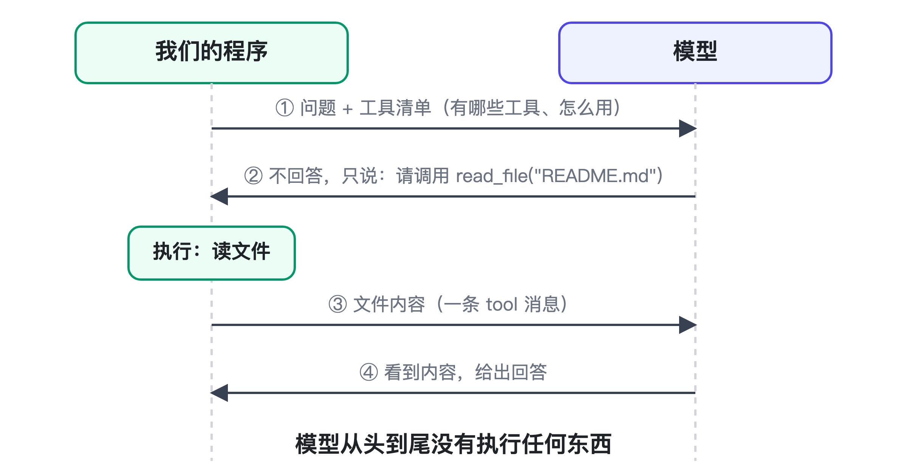

# 14 天入门 Agent 开发 D2 ｜ 工具调用：模型不会执行，它只会"请求"

> 代码仓库：https://github.com/rainstudiome/agent-14-days ，本篇代码在 `day02/` 目录。

昨天的模型只能说话。问它"这个项目怎么运行"，它要么说不知道，要么编一个看起来像样的答案，因为它根本看不到我们的项目。

今天给它一个工具：读文件。

先把结论放在前面：**从头到尾，模型都没有执行过任何东西。** 它只会说"我想调用 read_file，参数是 README.md"，真正去读文件的，是我们的程序。

## 今天的目标

1. 弄懂一次工具调用从头到尾发生了什么。
2. 亲眼看到来回的每一条消息长什么样。
3. 通过三个实验，看到"不让用工具""一轮不够""一次要两个"分别会怎样。

预计用时：40 分钟。今天用的还是昨天装好的环境，不用新装东西。

## 一、一次工具调用分四步

还记得昨天那个关在房间里的顾问吗？今天我们给他一张"服务清单"，告诉他：门外的人可以帮你读文件，需要的话就在纸条上写"读哪个文件"。

对应到程序里，一次工具调用分四步：



1. 程序 → 模型：问题 + 工具清单（有哪些工具、怎么用）。
2. 模型 → 程序：不回答问题，而是说"请帮我调用 read_file，参数是 README.md"。
3. 程序自己去读文件，把文件内容作为一条新消息交给模型。
4. 模型 → 程序：看到了文件内容，给出回答（或者再要一个工具）。

注意第②步：模型的回复里**没有答案**，只有一个请求。第③步才是真正干活的地方，干活的是我们的程序。

## 二、告诉模型有哪些工具

工具清单跟着请求一起发过去。打开 `day02/tool_call.py`，先看工具清单：

```python
TOOLS = [
    {
        "type": "function",
        "function": {
            "name": "read_file",
            "description": "读取示例项目里的一个文本文件，返回全文。",
            "parameters": {
                "type": "object",
                "properties": {
                    "path": {"type": "string", "description": "相对于项目根目录的路径，比如 README.md"},
                },
                "required": ["path"],
            },
        },
    }
]
```

看起来嵌套很多层，其实只有三个关键字段：

- **name**：工具的名字。模型请求工具时，用的就是这个名字。
- **description**：工具是干什么的。这一段会被发给模型，**它就是提示词的一部分**：写得含糊，模型就用不好。第 4 天专门讲怎么写。
- **parameters**：参数长什么样，用一种叫 JSON Schema 的格式描述。这里的意思是：参数是一个对象，里面有一个叫 `path` 的字符串，必填。

> 小知识：JSON Schema 是一种描述"数据长什么样"的通用格式。写过前端表单校验或者 TypeScript 类型的话，会觉得很眼熟：`"type": "string"` 就是"这是个字符串"，`"required": ["path"]` 就是"path 必须有"。

发请求时，把工具清单带上：

```python
resp = client.chat.completions.create(model=MODEL, messages=messages, tools=TOOLS)
```

和昨天相比，只多了 `tools=TOOLS` 这一个参数。

而真正干活的函数，模型永远碰不到：

```python
def read_file(path: str) -> str:
    """真正干活的函数。模型永远碰不到它，只有我们的程序会调用它。"""
    return (ROOT / path).read_text(encoding="utf-8")
```

`ROOT` 是练习项目 `sample_repo` 所在的目录。`ROOT / path` 是把目录和文件名拼成完整的路径，`read_text` 把文件内容读成字符串。

## 三、跑一遍，看每一条消息

```bash
uv run day02/tool_call.py
```

这个脚本把来回的每一条消息都打印出来，编了号，对应上面的四步。

**① 我们发出的问题**：

```json
{
  "role": "user",
  "content": "这个项目怎么运行？"
}
```

**② 模型的回复**。注意，这里没有答案：

```json
{
  "role": "assistant",
  "content": "我先查看项目里的文件，找到运行说明。",
  "tool_calls": [
    {
      "id": "call_00_ET_0I9QHYwLwZrNyD2VBH0j6020",
      "type": "function",
      "function": {"name": "read_file", "arguments": "{\"path\": \"README.md\"}"}
    }
  ]
}
```

- `content` 只有一句交代，有的模型干脆是空的。重点在下面。
- `tool_calls` 是一个列表，里面每一项是一个请求：调用哪个工具（`name`），参数是什么（`arguments`），还有一个编号（`id`）。
- `arguments` 是一个**字符串**，不是对象。你看它外面有引号，里面的引号都被转义成了 `\"`。程序要自己把它解析成对象，而且模型给的字符串有可能不是合法的 JSON。

**③ 程序执行工具，把结果交还给模型**：

```python
for call in msg.tool_calls:
    args = json.loads(call.function.arguments)  # arguments 是字符串，要自己解析
    try:
        result = read_file(**args)
    except Exception as e:
        result = f"出错：{e}"
    tool_message = {"role": "tool", "tool_call_id": call.id, "content": result}
    messages.append(tool_message)
```

一行一行看：

- `for call in msg.tool_calls:`：模型可能一次请求好几个工具，逐个处理。
- `json.loads(...)`：把字符串解析成字典，比如 `{"path": "README.md"}`。
- `read_file(**args)`：调用真正的函数。`**args` 的意思是把字典摊开当参数传进去，等于 `read_file(path="README.md")`。
- `try ... except`：读文件可能出错，比如文件不存在。出错时不让程序崩，而是把错误信息当作结果。
- 最后一行：把结果包成一条 `role` 为 `tool` 的消息，加进对话。`tool_call_id` 填的是请求的编号，表示"这是对那个请求的回复"。

**④ 第二次请求，模型看到了文件内容**。这时它有两种选择：直接回答，或者再要几个工具。我用 `deepseek-flash` 跑了几次，它每次都选了后者：

```
④ 模型还想再调工具： ['read_file', 'read_file']
   这个脚本只处理一轮。要让它一直调下去，就得写成循环，这是第 3 天的内容。
```

README 里写着"改端口、改数据库位置都用环境变量，见 `tinynotes/config.py`"，它想把 config.py 也看了再答。这是个谨慎的好习惯，可这个脚本只处理一轮，到这里就停了。

问一个 README 里就有完整答案的问题，比如"README 里写了什么？"，模型多半读完就直接回答，脚本会打印"④ 模型的最终回答"。不管哪种，**它说的每一句，都应该来自真的读到的文件**。

## 四、把整段对话串起来看

一次工具调用结束时，`messages` 里一共是这样五条：

| 顺序 | role | 内容 |
|---|---|---|
| 1 | system | 你是代码仓库助手。需要看文件时就调用工具，不要猜。 |
| 2 | user | 这个项目怎么运行？ |
| 3 | assistant | "我先查看项目里的文件……"，请求调用 `read_file({"path": "README.md"})`，编号 call_00_ET_… |
| 4 | tool | 对应编号 call_00_ET_…：README.md 的全文 |
| 5 | assistant | 要么是回答，要么又是一次工具请求 |

模型要是又请求了工具，就再执行、再交回去，第 4、5 条这样一对一对往下接。这就是明天的循环。

这里有两条规矩，模型的接口会检查，不遵守就报错：

1. **tool 消息前面，必须有一条带 `tool_calls` 的 assistant 消息。** 模型得先"说过"它要调工具，你才能把工具结果交给它。所以第②步的回复（L67-L74），要原样加进 messages（代码里的 `messages.append(assistant)`）。
2. **两者靠编号配对。** tool 消息的 `tool_call_id`，要等于请求里的 `id`。模型一次请求了几个工具，就要有几条对应的 tool 消息。

另外留意成本：**一次工具调用，至少要请求两次模型。** 而且第二次请求带着工具的结果。读一个长文件，输入 token 就多出一大截。

## 五、实验

### 实验一：不让用工具

打开 `day02/tool_call.py`，找到第一次请求那一行，在末尾加一个参数 `tool_choice="none"`：

```python
resp = client.chat.completions.create(model=MODEL, messages=messages, tools=TOOLS, tool_choice="none")
```

然后问一个只有项目里才有答案的问题：

```bash
uv run day02/tool_call.py "一条笔记最多能写多少字？"
```

**你会看到**：模型不能查，只能凭印象答。它可能会给出一个看似合理的数字，但这是编的。（正确答案是 2000，写在 `tinynotes/config.py` 里。）

**该查的没查，是 Agent 编造答案最常见的原因。**

`tool_choice` 有几种取值：

| 取值 | 意思 |
|---|---|
| `"auto"` | 默认值，模型自己决定用不用工具 |
| `"none"` | 不许用工具 |
| `"required"` | 必须用一个工具 |
| 指定某个工具 | 必须用这个工具 |

做完记得把 `tool_choice="none"` 删掉。

### 实验二：一轮不够

```bash
uv run day02/tool_call.py "默认端口是多少？"
```

README 里没写端口，只写了"见 `tinynotes/config.py`"。模型读完 README，很可能还想读 config.py。

**你会看到**：脚本打印"④ 模型还想再调工具"，然后就结束了。因为这个脚本只处理一轮。要让模型一直查下去，就得写成循环，这就是明天的内容。

### 实验三：一次要两个

```bash
uv run day02/tool_call.py "README 和 pyproject.toml 里分别写了什么？"
```

**你可能会看到**：模型在同一个回复里请求了两次 `read_file`，一个读 README，一个读 pyproject.toml。`tool_calls` 列表里有两项，脚本用 `for` 循环逐个执行，每个结果对应一条 tool 消息。有的模型也可能分两轮要，这取决于模型。

## 六、常见报错

| 看到的错误 | 原因 | 怎么办 |
|---|---|---|
| 400，大意是 tool 消息前面缺少带 tool_calls 的 assistant 消息 | 忘了把模型的回复加进 messages，或者加的时候丢了 `tool_calls` 字段 | 检查 `messages.append(assistant)` 那一行 |
| 模型根本不调用工具，直接回答 | 有的模型不支持工具调用；或者工具说明写得太含糊 | 换一个支持工具调用的模型；把说明写清楚 |
| `json.decoder.JSONDecodeError` | 模型给的参数不是合法的 JSON | 小模型常见。第 4 天会教你把这种错误交还给模型，让它重来 |
| 用了思考模式，报错说缺少思考内容 | 有的思考模型要求把上一轮的思考内容原样带回去 | 明天的代码里，`assistant_message` 函数处理了这种情况 |

## 今天记住三件事

1. 模型只输出"调哪个工具、参数是什么"，执行的是你的程序。
2. 一次工具调用至少请求两次模型，工具的结果也算输入 token。
3. `arguments` 是字符串，要自己解析，也可能解析失败。

## 练习

1. 加一个 `list_files` 工具，让模型先看目录，再决定读哪个文件。
   提示：照着 `read_file` 写一个函数，用 `(ROOT / path).iterdir()` 列出目录里的东西；再在 `TOOLS` 里加一项说明。
2. 打印两次请求的 `usage`，第二次多花了多少 token？
3. 把 `description` 删掉，只留名字，看模型还会不会用这个工具。

参考答案和代码在 [`solutions/`](solutions/) 目录，先自己做一遍再看。

## 明天

真实的问题往往要查好几步。明天把今天的代码改成循环：一个不到 100 行的 Agent。

## 参考

- DeepSeek 的 Function Calling 文档：[https://api-docs.deepseek.com/zh-cn/guides/function_calling](https://api-docs.deepseek.com/zh-cn/guides/function_calling)
- JSON Schema 入门：[https://json-schema.org/learn/getting-started-step-by-step](https://json-schema.org/learn/getting-started-step-by-step)
- learn-claude-code 第 2 课 Tool Use：[https://github.com/shareAI-lab/learn-claude-code](https://github.com/shareAI-lab/learn-claude-code)
